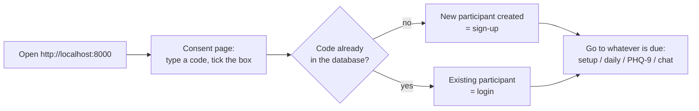
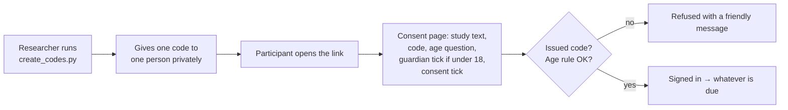
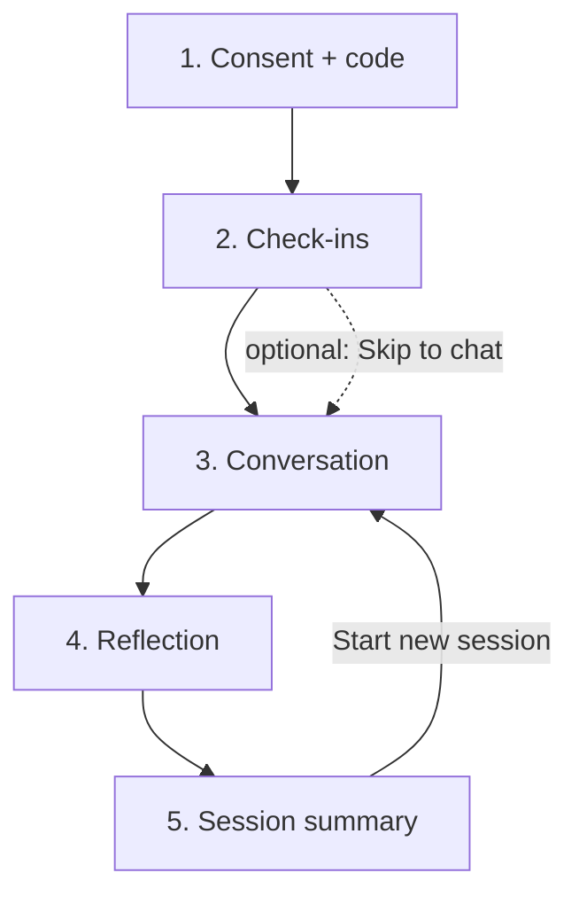
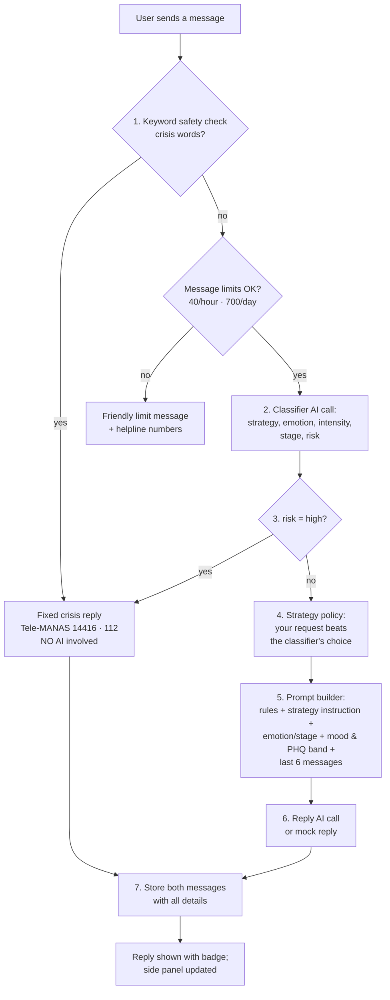
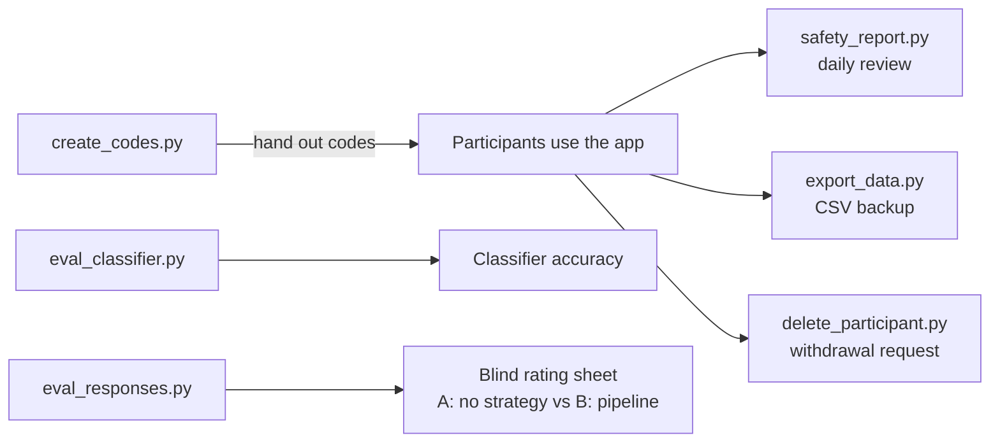

# Stillspace: How the App Flows

> A plain-language map of **who uses the app, how they get in, and what happens behind each click**.
> For file-by-file details see `docs/ARCHITECTURE.md`; for safety see `docs/SAFETY.md`; for going online see `docs/DEPLOYMENT.md`.
> GitHub shows the diagrams below as pictures (Mermaid). In other viewers they appear as text.

---

## 1. Who uses Stillspace

| Person | What they do | Where |
|---|---|---|
| **Participant** | Enters a code, does check-ins, chats, reflects, sees a summary | The web page (browser or phone) |
| **Researcher / mentor** | Creates codes (online), reviews safety flags, exports data, deletes data on request, runs evaluations | PowerShell scripts in `scripts/` |
| **Student developer** | Builds the "brain" (safety, classifier, policy, prompt, LLM call) in `student_starter/` | VS Code + terminal |

## 2. Two modes, same code

| | **Local mode** (default) | **Online mode** (`APP_ENV=production`) |
|---|---|---|
| Used for | Building, testing, teaching, demos | A real, approved study with shared link |
| Database | SQLite file `data/stillspace.db` (or Supabase if `DATABASE_URL` is set) | Supabase (Postgres) |
| AI model | Mock replies, Ollama (free, local) or OpenRouter | OpenRouter (paid credits) |
| Who can get in | **Anyone, with any new code** | **Only codes the researcher issued** |
| Consent page | Short consent + tick box | + study text, age question, guardian consent for under-18s |
| Demo "preview day" buttons, `/docs` page | On | Off |
| Limits | 40 messages/hour/participant, 700/day total (same settings) | Same, important for cost |

---

## 3. Can new users sign up? Log in?

**There are no accounts, passwords or emails** (spec section 4). A participant is just a **pseudonymous code** such as `P001` or `SS-7K3M-Q9TX`. The code is the only thing that links a person to their answers, so their name is never stored.

The code is typed **once**, at sign-in. The server then gives the browser a random **sign-in token**, and every later request carries that token instead of the code. The server works out *who* is asking from the token, so nobody can reach another person's data by sending a different code or session number (D-60).

### Local mode: "sign-up" happens automatically

- Typing **any new valid code** (3–20 letters, digits or hyphens) creates a participant. `p001` and `P001` are the same person.
- Typing the **same code again later** brings back their history (check-ins, preference, PHQ-9 results).

### Online mode: no self sign-up, only issued codes

- **Why no sign-up button?** Online, everyone is a research participant. Codes make sure consent (and guardian consent for under-18s) came first, that the follow-up adult can reach a flagged person, and that a withdrawal can be honoured. See `docs/DEPLOYMENT.md` §2 for the full reasons, how to create and hand out codes, and what a public version would need.
- Made-up or test codes (like `P001`) are **refused**, even if they exist in the database from testing.
- Too many attempts from one IP address (10 per minute) are slowed down, so codes can't be guessed.
- The age answer, guardian confirmation and time of consent are stored with the participant.

### Staying signed in, signing out, other devices
| Situation | What happens |
|---|---|
| Refresh the page (F5) | Still signed in (the sign-in token is kept in this browser tab's `sessionStorage`; the code is not stored) and taken to whatever is due |
| Close the tab and come back | Type the code again (nothing is remembered between tabs, on purpose) |
| **Switch participant** link (sidebar) | Signs out: the token is deleted on the server and in the tab; back to the consent page |
| After 12 hours (`SIGN_IN_HOURS`) | The sign-in expires; the page asks for the code again. A crisis message still gets the safety reply |
| Another computer or phone | Works: type the same code (online mode) |
| Forgot the code | The researcher looks it up in their private code list; there is no "reset password" |

---

## 4. A participant's journey (and what happens behind it)

| Step | What the participant sees | What happens behind (API call → tables) |
|---|---|---|
| **1. Consent** | Welcome page, code field, consent tick (online: study text + age) | `POST /api/participants` → `participants` |
| **2a. Setup** (once) | Date of birth (optional), preferred support style | `POST /api/checkins` type `setup` → `checkins`, updates `participants` |
| **2b. Daily** (once a day) | Mood (Low…Good), "Would you like support today?" | `type daily` → one row per day, later saves merge into it |
| **2c. Every two weeks** | PHQ-9 (9 questions) + wellbeing questions | `type fortnightly` → server scores PHQ-9; total only if all 9 answered; item 9 > 0 sets a flag |
| **3. Conversation** | Chat with badges showing the strategy; side panel shows emotion · intensity · stage | `POST /api/sessions` (once) then `POST /api/chat` per message → `sessions`, `messages` |
| **4. Reflection** | 3 optional questions | `POST /api/sessions/{id}/end`, then `type post_session` (or Skip = nothing saved) |
| **5. Summary** | Time, messages, latest PHQ-9, strategy bars, reflection | `GET /api/sessions/{id}/summary` |

**What's due is decided by the server** (`backend/checkins.py`), using the date in `APP_TIMEZONE` (Asia/Kolkata):
- **setup** → due until it's done once
- **daily** → due if there's no daily check-in for today
- **every two weeks** → due if there's none yet, or the last one is 14+ days old

The side panel's **mood buttons** and **"Requested by you"** save immediately. In local demo mode, **Next day / 14 days later** (on the summary page) move a pretend date forward so you can test the schedule.

---

## 5. What happens when a message is sent

Key rules:
- **Safety comes first and never needs the AI.** It works in mock mode, offline, or when the model is broken, and is never rate-limited.
- **"Requested by you" wins** over the classifier (spec 11.2). "Automatic" uses the classifier.
- **Privacy:** only today's mood and the PHQ-9 **band** (e.g. "moderate range") go into the prompt. **Never** individual PHQ answers or the date of birth.
- **Errors:** if the model can't be reached, the page shows a friendly message with **Retry**, and nothing is saved.

## 6. Safety in one picture

| Trigger | What the participant sees | What's recorded |
|---|---|---|
| Crisis words in a message (English, Hinglish, Devanagari; spelling tricks handled) | Fixed reply in a gold box, **"Safety response"** badge, tap-to-call helplines | `safety_flag=keyword` + matched rule id |
| Classifier says `risk: high` | Same fixed reply | `safety_flag=classifier` |
| PHQ-9 item 9 answered above 0 | Follow-up notice with helplines | `item9_flag=1` |
| Any of the above | Right panel: **"Follow-up needed"** (never a percentage) | Listed by `scripts/safety_report.py` |

Online, the named adult in `FOLLOWUP_CONTACT` runs the safety report on an agreed schedule (there is no automatic alert, by choice).

---

## 7. The researcher's side

| Task | Command (project folder, venv active) |
|---|---|
| Create codes (online) | `python scripts/create_codes.py --count 20` |
| Review safety flags | `python scripts/safety_report.py --days 1` |
| Export all data to CSV | `python scripts/export_data.py` |
| Delete a participant | `python scripts/delete_participant.py SS-XXXX-XXXX` |
| Classifier accuracy | `python scripts/eval_classifier.py` |
| Reply rating sheet | `python scripts/eval_responses.py --limit 10` → rate the blind sheet → `--summarise <file>` |

## 8. Where data goes

| Data | Stored in | Leaves the computer? |
|---|---|---|
| Codes, check-ins, PHQ-9, messages, reflections | SQLite file (local) or Supabase (online) | Only to your own Supabase project when `DATABASE_URL` is set |
| Chat message text | Database + sent to the AI model to get a reply | **Yes**, to the AI provider (OpenRouter), except in mock mode or with local Ollama |
| PHQ-9 answers, date of birth | Database only | **Never** sent to the AI |
| API keys, database password | `.env` (local) or the host's settings (online) | Never sent to the browser, never committed to git |

---

## 9. Quick answers

| Question | Answer |
|---|---|
| Can new users sign up? | **Local:** yes, by typing a new code. **Online:** no; the researcher issues codes with `python scripts/create_codes.py --count 20` and hands them out privately (invite-only on purpose, see `docs/DEPLOYMENT.md` §2). |
| Shouldn't everyone be able to use it? | Everyone *you invite* can, in any number (codes can go out in batches). Open sign-up would turn a supervised study into a public mental-health service, which needs 18+ only, verified accounts, a privacy policy, monitoring and new ethics approval. Not built, on purpose. |
| Can users log in? | Yes, by typing their code (online: plus age question and consent). No password. |
| Can a user see someone else's data? | No. After sign-in every request carries a sign-in token, and the server takes the participant **from the token**: there is no way to ask for another person's data. Session ids are checked against that participant. Online codes are random and sign-in attempts are limited, so codes can't be guessed. Tokens expire and only their hash is stored. |
| What does a user need? | A browser and their code. Nothing to install. |
| What does the person running it need? | Local: Python + this project (`docs/SETUP.md`). Online: Supabase + OpenRouter + Railway/Render (`docs/DEPLOYMENT.md`). |
| Does it work without internet? | Yes, in **mock mode** (no API key) or with Ollama. |
| Is it therapy? | **No.** A student research prototype; not therapy, diagnosis or an emergency service. In an emergency: **112** or **Tele-MANAS 14416**. |
